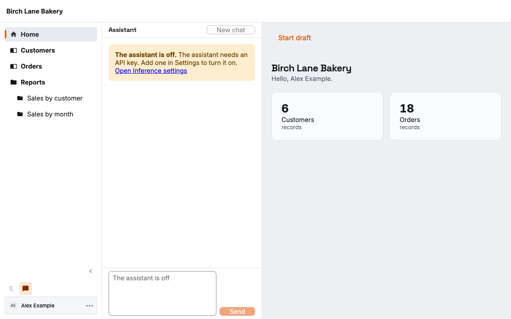
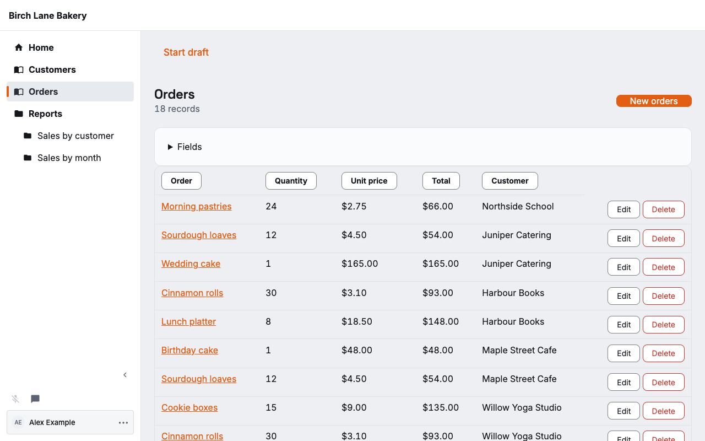
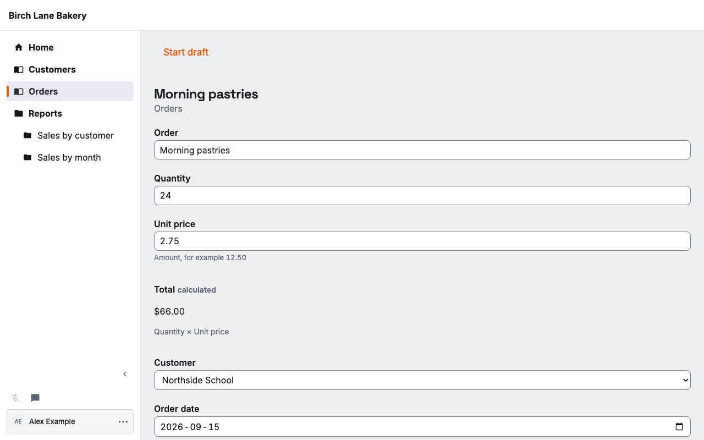
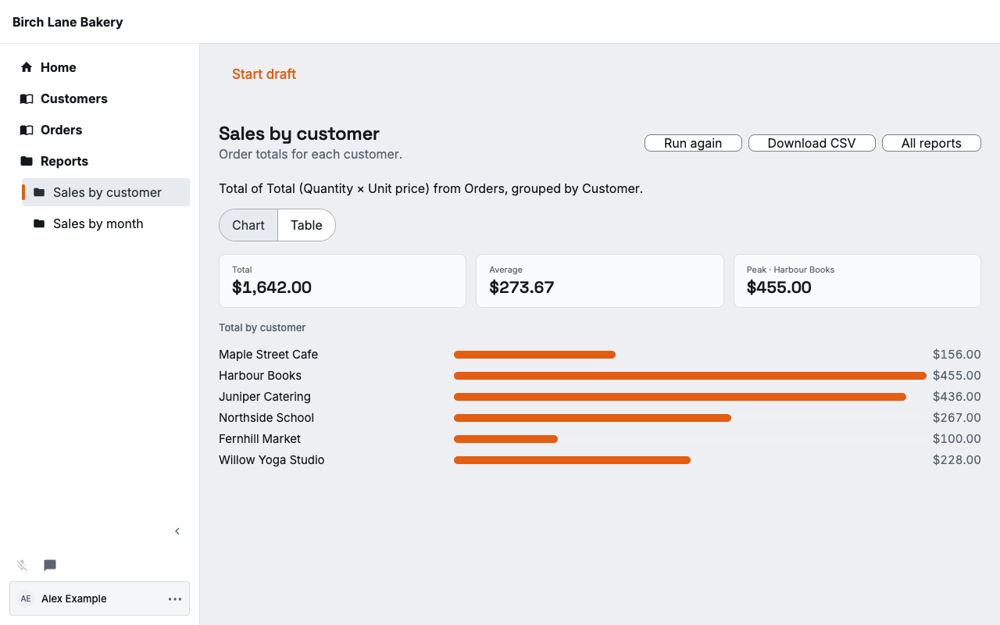
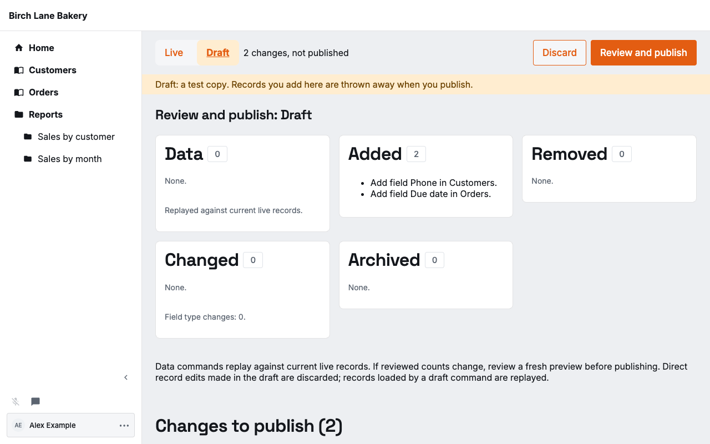
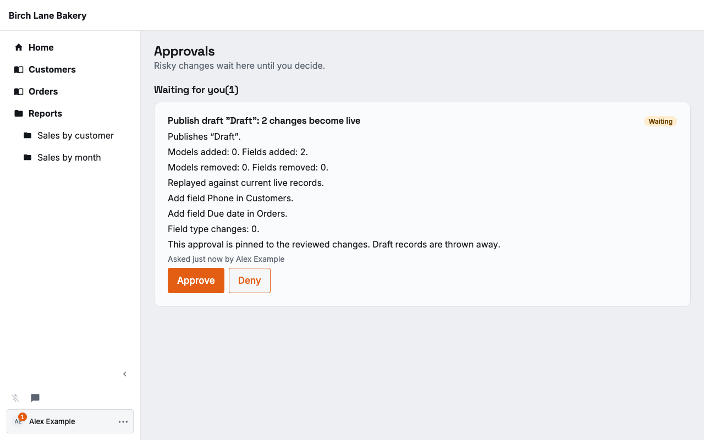
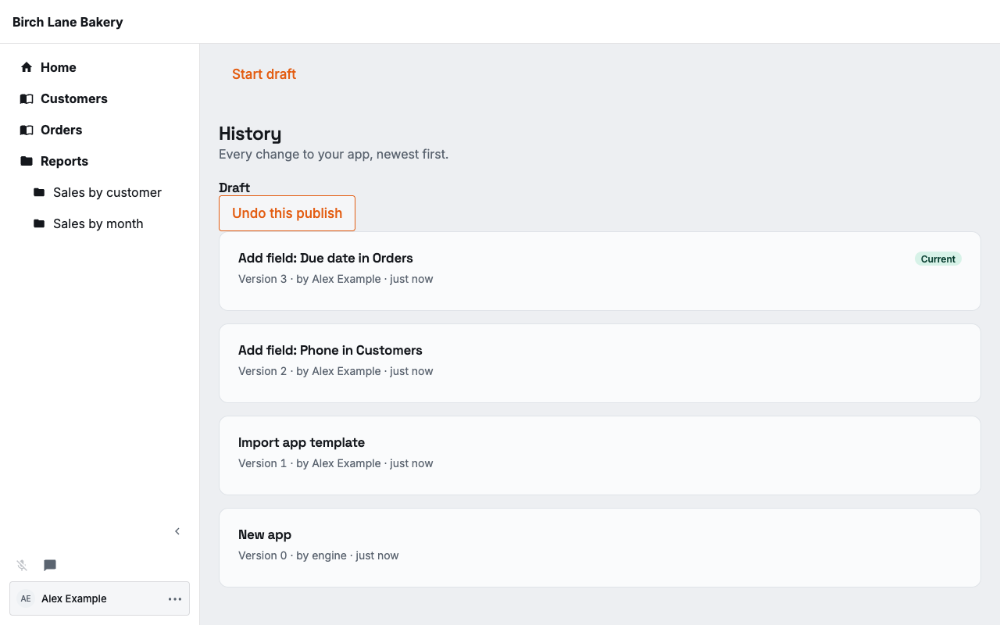

# Tricia

**[Download](https://tricia.happyvertical.com/download)** ·
**[Documentation](https://tricia.happyvertical.com/docs)** ·
[Home page](https://tricia.happyvertical.com)

Tricia is an open source desktop app for one person: the owner. She is being built to turn the
spreadsheets a business already runs on into a real app, with lists, forms and reports, and to be
changed afterwards by talking to a built-in assistant. The owner directs every change, risky
changes wait for their approval, and changes are kept in a history. Data lives in a local database
on the owner's machine, and the assistant runs on the owner's own AI account.

Tricia is the [smrt](https://github.com/happyvertical/smrt) app shell with its built-in assistant,
packaged as a desktop app.

## Status

Tricia is **not released yet**. There is no installer, and signing is not done. Only macOS and
Linux are planned so far.

- **Works in the app shell today:** building and changing lists and fields, calculated fields,
  reports with a CSV download, drafts you review before publishing, approval for risky changes, and
  a history with undo.
- **Being built for Tricia:** spreadsheet import, which is required before she ships, and loading
  data in bulk.
- **Planned:** optional cloud services.

The [download page](https://tricia.happyvertical.com/download) explains how to run the app shell
from source today.

## Screenshots

These show the app shell on smrt 0.62.0, in a made-up bakery with invented data. They are not
Tricia's final look, and spreadsheet import is not in them yet: they will be added to this list when
it is released. The assistant is off in them because no AI account is connected.



_An app's home page, with the assistant beside it._



_A list. The total is a calculated field._



_A form. The calculated total shows its formula and cannot be edited by hand._



_A report, as a chart or a table, with a CSV download._



_A draft: a test copy of the app, reviewed before it is published._



_Publishing is a risky change, so it waits for the owner's approval._



_The history, with undo._

The screenshots are regenerated by a script. See [`tools/screenshots`](tools/screenshots).

## How it is built

- [smrt](https://github.com/happyvertical/smrt) provides the app shell, the assistant and the
  toolkit. The shared code lives there.
- This repository holds the [homepage](apps/web), a static SvelteKit site served at
  [tricia.happyvertical.com](https://tricia.happyvertical.com). Releases and the update feed for the
  desktop app will be published here once there is a release, and the desktop app will live in
  `apps/desktop`.

## Run it

Follow the [download page](https://tricia.happyvertical.com/download) to run the app shell from
source. To work on the homepage, you need Node 26 and pnpm 11:

```sh
pnpm install
pnpm dev         # local dev server
pnpm build       # static site in apps/web/build
pnpm typecheck
pnpm lint        # Biome
```

See [`apps/web/README.md`](apps/web/README.md) for details.

## Contributing and issues

Please [open an issue](https://github.com/happyvertical/tricia/issues) to report a problem or
suggest a change, and open a pull request against `main` with checks passing (`pnpm lint`,
`pnpm typecheck`, `pnpm build`). Changes to the app shell itself belong in the
[smrt repository](https://github.com/happyvertical/smrt).

## Licence

MIT. See [LICENSE](LICENSE).
